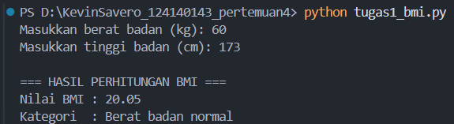
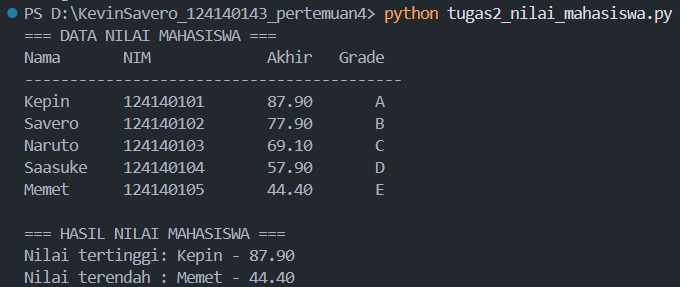
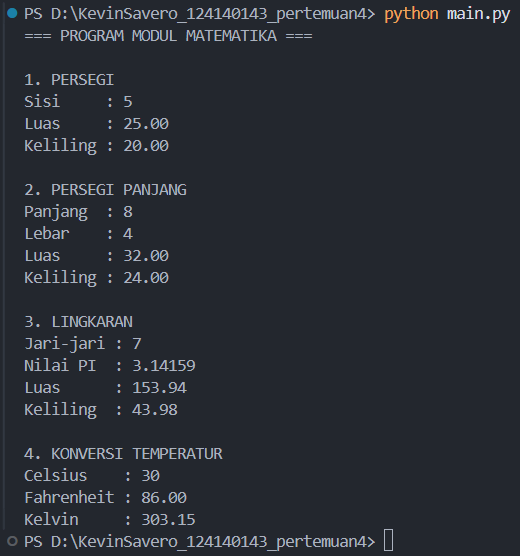

# Praktikum Dasar Pemrograman Python - Pertemuan 4

## Identitas Mahasiswa

- **Nama:** Kevin Savero
- **NIM:** 124140143
- **Kelas:** RA

## Deskripsi Tugas

### 1. Program Perhitungan BMI (`tugas1_bmi.py`)

Program ini dibuat untuk mengetahui nilai Body Mass Index (BMI) berdasarkan berat dan tinggi badan seseorang. Pengguna diminta memasukkan berat badan dalam satuan kilogram serta tinggi badan dalam sentimeter. Data tersebut kemudian diproses menggunakan rumus BMI untuk mendapatkan hasil perhitungan.

Setelah nilai BMI diperoleh, program menggunakan struktur percabangan `if-elif-else` untuk mengelompokkan hasil ke dalam empat kategori, yaitu berat badan kurang, normal, berlebih, dan obesitas.

### 2. Program Pengolahan Nilai Mahasiswa (`tugas2_nilai_mahasiswa.py`)

Pada program kedua, data mahasiswa disimpan menggunakan kombinasi list dan dictionary. Terdapat lima data mahasiswa yang masing-masing memiliki informasi nama, NIM, nilai UTS, nilai UAS, dan nilai tugas.

Program menghitung nilai akhir dengan menerapkan bobot 30% untuk UTS, 40% untuk UAS, dan 30% untuk nilai tugas. Selanjutnya, hasil perhitungan digunakan untuk menentukan grade dari A hingga E. Seluruh hasil ditampilkan dalam bentuk tabel, termasuk informasi mahasiswa dengan nilai paling tinggi dan paling rendah.

### 3. Modul Operasi Matematika (`math_operations.py` dan `main.py`)

Bagian ketiga membahas penggunaan modul buatan sendiri dalam Python. File `math_operations.py` berisi beberapa fungsi untuk melakukan perhitungan geometri, meliputi luas dan keliling persegi, persegi panjang, serta lingkaran.

Modul tersebut juga menyediakan fungsi untuk mengubah temperatur dari Celsius ke Fahrenheit dan Kelvin. Konstanta `PI` digunakan sebagai nilai tetap dalam perhitungan lingkaran.

File `main.py` berperan sebagai program utama yang mengimpor dan menjalankan fungsi-fungsi dari modul tersebut. Proses impor dilakukan menggunakan dua bentuk penulisan, yaitu `import math_operations` dan `from math_operations import`.

## Langkah Menjalankan Program

Untuk menjalankan seluruh program, buka folder tugas menggunakan Visual Studio Code, kemudian pilih menu Terminal dan buka terminal baru.

Pastikan Python sudah terpasang pada perangkat.

**Soal 1 - Perhitungan BMI**

Jalankan perintah berikut:

```bash
python tugas1_bmi.py
```

Masukkan berat badan dan tinggi badan ketika program meminta data.

**Soal 2 - Pengolahan Nilai Mahasiswa**

Jalankan perintah:

```bash
python tugas2_nilai_mahasiswa.py
```

Program akan menampilkan tabel nilai mahasiswa beserta grade, nilai tertinggi, dan nilai terendah.

**Soal 3 - Operasi Matematika**

Jalankan perintah:

```bash
python main.py
```

Pastikan file `main.py` dan `math_operations.py` berada dalam direktori yang sama agar modul dapat dipanggil dengan benar.

## Dokumentasi Hasil Praktikum

### 1. Dokumentasi Program BMI

Screenshot berikut berisi bukti ketika program perhitungan BMI dijalankan melalui terminal.

Simpan gambar dengan nama `screenshot_bmi.png` di dalam folder `screenshots`.



### 2. Dokumentasi Program Nilai Mahasiswa

Bagian ini menampilkan hasil pengujian program pengolahan nilai mahasiswa, mulai dari tabel nilai hingga pencarian nilai tertinggi dan terendah.

Simpan gambar dengan nama `screenshot_nilai_mahasiswa.png` di dalam folder `screenshots`.



### 3. Dokumentasi Modul Matematika

Screenshot ini menunjukkan hasil penggunaan fungsi-fungsi pada modul matematika, termasuk perhitungan geometri dan konversi temperatur.

Simpan gambar dengan nama `screenshot_modul_matematika.png` di dalam folder `screenshots`.



## Struktur Direktori

```text
Kevin_Savero_124140143_pertemuan4/
│
├── tugas1_bmi.py
├── tugas2_nilai_mahasiswa.py
├── math_operations.py
├── main.py
├── README.md
├── .gitignore
│
└── screenshots/
    ├── screenshot_bmi.png
    ├── screenshot_nilai_mahasiswa.png
    └── screenshot_modul_matematika.png
```

Folder `venv` dan `__pycache__` tidak disertakan dalam repositori karena tidak diperlukan untuk pengumpulan tugas.